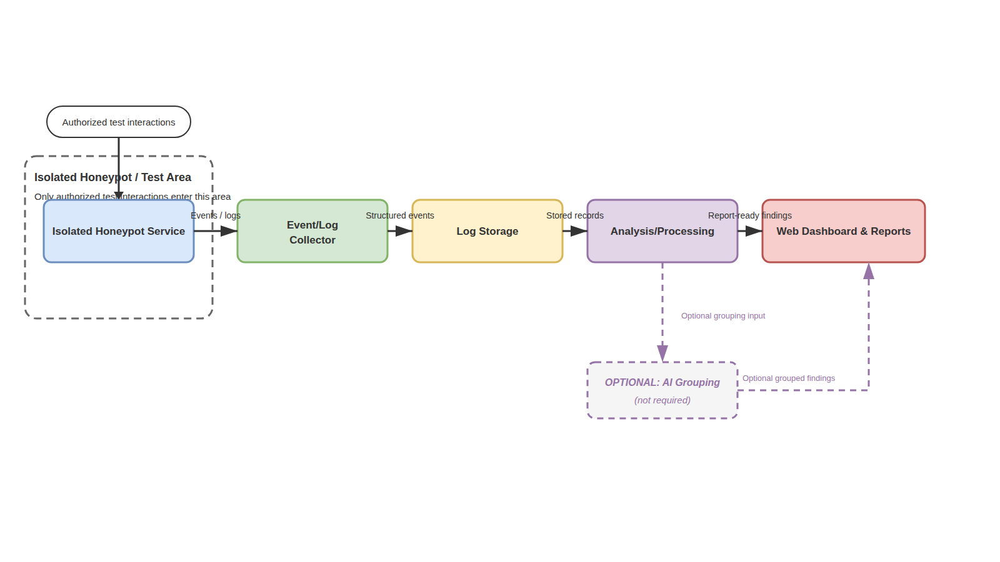

# CyberBee Software Architecture

## 4. Software Architecture

The architecture below is a planned software-only view of the CyberBee system. It is not a hardware diagram and does not represent a deployed or executed system.

### Software Component Table

| Component | Purpose | Input | Output | Candidate software / TBD |
|---|---|---|---|---|
| Isolated Honeypot Service | Provides a contained area for authorized test interactions and records suspicious activity. | Authorized test traffic and test interactions | Honeypot events, interaction records, and service-generated logs | TBD |
| Event/Log Collector | Receives records from the honeypot service and normalizes them for downstream processing. | Honeypot events and service-generated logs | Structured events ready for storage | TBD |
| Log Storage | Persists structured events for later analysis and reporting. | Structured events | Stored event/log records | TBD |
| Analysis/Processing | Filters and analyzes stored events to identify patterns and produce findings. | Stored event/log records | Analysis results and report-ready data | TBD |
| Optional AI Grouping | Optionally groups or summarizes related findings. This step is not required. | Analysis results | Optional grouped findings or summaries | TBD |
| Web Dashboard & Reports | Presents findings and reports to authorized users. | Report-ready analysis data and optional grouped findings | Web views and exported reports | TBD |